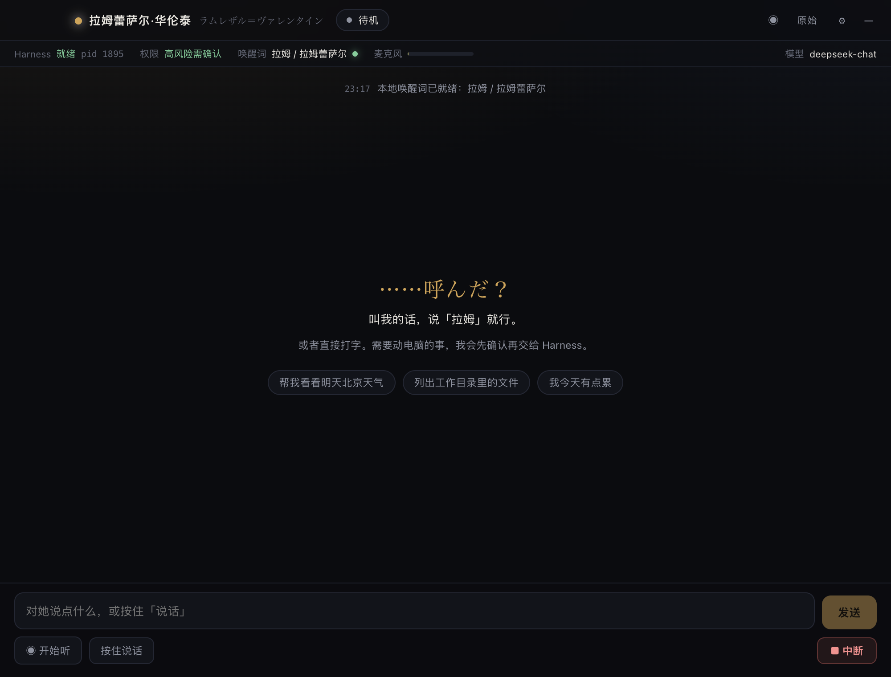

# Eidolon Assistant

一个 macOS 语音角色助手：**你说话，角色回应；需要操作电脑时，交给本机 DeepSeek Harness 执行。**

角色有自己的声音、人设和唤醒词。你可以和角色闲聊，也可以让它查资料、读写文件、运行命令。
任务开始前角色会用角色口吻向你确认；执行结果用日语台词 + 中文字幕汇报。



> 这是**源码项目**，不是一键安装的 `.app`。
> 需要 macOS、Python、Node.js、DeepSeek Harness，并自己填写 API key。
> **部署步骤在下面的「部署（重点）」；完整手册见 [INSTALL.md](INSTALL.md)。**

## 玩法

- **语音唤醒**：说「拉姆」唤醒默认角色；切换角色后使用该角色的中文唤醒词。
- **聊天 + 任务**：闲聊直接回答；说「帮我查一下明天的天气」「把桌面上的文件整理一下」会进入任务流程。
- **先确认再执行**：删除、覆盖、运行命令等操作会先问你是否允许；拒绝就不执行。
- **随时打断**：说话中可以按「中断」停止 TTS 和任务。
- **看原始过程**：原始面板能看到 Harness 实际执行的命令和输出，不只是角色的总结。
- **多角色**：拉姆蕾萨尔和二阶堂希罗可切换；每个角色有自己的声音、唤醒词、人设和回应方式。
- **角色包**：`.eidolon` 文件可导入/导出，可以自己做角色或分享别人的角色。
- **语音设置**：设置里可选麦克风、看实时电平、调 VAD 阈值、静音判定和唤醒灵敏度。

## 角色

仓库自带两个可导入角色：

```text
characters/
├── ramlethal.eidolon   # 拉姆蕾萨尔，默认导入
└── hiro.eidolon        # 二阶堂希罗
```

- 拉姆蕾萨尔：默认角色，安装时自动导入。
- 二阶堂希罗：进入 **设置 → 角色 → 导入 .eidolon**，选择 `characters/hiro.eidolon`。

角色包只以 `.eidolon` 形式保存，不再把 `sheet.md`、`character.toml`、头像散落在仓库里。
想制作新角色，看 [docs/CHARACTER-AUTHORING-PROMPT.md](docs/CHARACTER-AUTHORING-PROMPT.md)。

## 部署（重点）

### 先准备

- macOS 13 或更新版本（主要在 Apple Silicon 上测试）。
- Python **3.12+**。
- Node.js **20+**。
- 已安装并登录 **DeepSeek Harness 桌面版**。
- DeepSeek、阿里云百炼（DashScope）、Fish Audio 三个 API key。

### 三步启动

```bash
# 1. 下载并安装依赖（自动建 venv、装 npm、下载 KWS 模型、导入默认角色）
git clone https://github.com/WONJU080/eidolon-assistant.git eidolon-assistant
cd eidolon-assistant
./scripts/setup.sh

# 2. 填 API key（二选一）
open -e config/local.env
# 或从已有 .env 导入：
# ./scripts/import_keys.sh /path/to/your.env

# 3. 启动
./scripts/run.sh
```

**`setup.sh` 只需要跑一次。** 它做的是：

1. 检查 Python/Node 版本；
2. 创建 `.venv`，安装 backend；
3. 安装 `desktop/node_modules`；
4. 构建桌面端；
5. 下载 KWS 唤醒模型；
6. 创建 `config/local.env`（权限 600）；
7. 把 `characters/ramlethal.eidolon` 导入到运行目录。

更细的逐步说明、手动安装和故障排查在 **[INSTALL.md](INSTALL.md)**。

## 第一次启动

1. macOS 会询问麦克风权限：允许 **Eidolon Assistant/Electron**（用 `backend.sh` 时是 **Terminal**）。
2. 在输入框发一句「你好」，确认角色能回复。
3. 按「开始听」说一句「拉姆」，确认唤醒和语音。
4. 打开 **设置 → 麦克风与唤醒**，选输入设备，确认实时电平。
5. 打开 **设置 → 角色**，可导入希罗并切换。

## 密钥

仓库里没有真实密钥。`config/local.env` 被 `.gitignore` 忽略。

```text
CHAT_LLM_BASE_URL=https://api.deepseek.com/v1
CHAT_LLM_MODEL=deepseek-chat
CHAT_LLM_API_KEY=...
DASHSCOPE_API_KEY=...
FISH_AUDIO_API_KEY=...
```

- 模板：[config/local.env.example](config/local.env.example)
- 导入已有 `.env`：`./scripts/import_keys.sh /path/to/your.env`
- 文件权限应为 `600`；不要提交、截图或上传。
- 没有 key 时 app 仍能启动，但对应服务不可用。

## 常用命令

```bash
./scripts/run.sh                  # 构建并启动 Electron 桌面应用
./scripts/dev.sh                  # 开发模式（热更新）
./scripts/backend.sh --port 8799  # 只启动 backend，浏览器打开 http://127.0.0.1:8799/
./scripts/check.sh                # 检查依赖/模型/角色/配置
./scripts/test.sh                 # 运行测试和构建
```

## 简单原理

角色层负责对话、判断、确认和转达；真正的文件/命令/网页操作由本机 DeepSeek Harness 执行。
语音识别走 DashScope，TTS 走 Fish Audio，聊天走 DeepSeek；密钥只存本地。

## 注意

- 只支持 macOS；当前主要验证 Apple Silicon。
- 不是签名/公证的 app，没有 DMG、没有首启向导、没有自动更新。
- 任务操作需要 DeepSeek Harness 已安装并登录；本项目不包含它。
- 角色头像/人设来自原作品；公开分发前请确认版权。
- 默认音色来自原项目的 Fish Audio reference id；分享角色包时建议换成自己的音色 id。
- 角色包只支持 `character.toml`、`sheet.md`、`assets/` 图片、`README/LICENSE`。

## 开发与测试

```bash
./scripts/test.sh
```

会运行 43 个 backend 测试、TypeScript 检查和桌面端构建。

更多内部资料：

- [INSTALL.md](INSTALL.md) — 第一次安装
- [docs/development/HANDOFF_PROMPT.md](docs/development/HANDOFF_PROMPT.md) — 项目背景
- [docs/P0-VERIFICATION.md](docs/P0-VERIFICATION.md) — 语音/ACP 验证
- [docs/CHARACTER-AUTHORING-PROMPT.md](docs/CHARACTER-AUTHORING-PROMPT.md) — 角色制作提示词

## License

当前仓库还没有添加 LICENSE。公开使用/分发前请先确定代码许可证；角色图片、角色人设和
KWS 模型分别受原作品/模型许可证约束。
